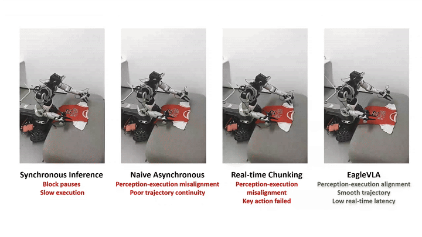
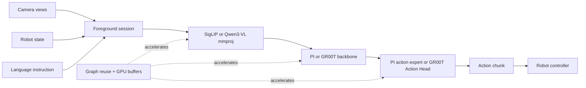

<div align="center">
  <p>
    <a href="https://www.pku.edu.cn/"></a>
    &nbsp;&nbsp;&nbsp;&nbsp;&nbsp;&nbsp;
    <a href="https://www.tlaic.ac.cn/"></a>
  </p>

  

  <p><strong>A llama.cpp-based inference engine for real-time onboard Vision-Language-Action control.</strong></p>
  <p>Run VLA locally on NVIDIA Jetson, desktop GPUs, CPUs, NPUs, and other edge platforms through a persistent robot-facing HTTP runtime.</p>

  <p>
    <a href="https://arxiv.org/abs/2607.12659"></a>
    <a href="https://www.corl.org/"></a>
    <a href="https://github.com/PKU-SEC-Lab/EagleVLA"></a>
    <a href="https://huggingface.co/diantoudefengshan/EagleVLA-GGUF"></a>
    <a href="https://github.com/ggml-org/llama.cpp"></a>
    <a href="https://github.com/flashrt-project/FlashRT"></a>
  </p>

  <p>
    <a href="#real-world-demo">Demo</a> ·
    <a href="#quick-start">Quick Start</a> ·
    <a href="#gr00t-n17-c-api-and-server">GR00T APIs</a> ·
    <a href="#performance-on-rtx-4090-jetson-orin-and-thor">Performance</a> ·
    <a href="docs/model_conversion.md">Model Conversion</a> ·
    <a href="docs/foreground_server_usage.md">Server API</a> ·
    <a href="#citation">Citation</a>
  </p>
</div>

---

## News

- **[2026/09] 🎉🎉🎉 EagleVLA has been accepted as a Spotlight at CoRL 2026!**
- **[2026/08] Pre-converted GGUF checkpoints are available.** Ready-to-use PI0, PI0.5, and GR00T N1.7 main-model and vision-projector GGUF files are released on [Hugging Face](https://huggingface.co/diantoudefengshan/EagleVLA-GGUF).
- **[2026/08] NVIDIA Isaac GR00T N1.7 inference is available.** Convert the official checkpoint to GGUF and run the complete Qwen3-VL backbone, Action Head, and four-step action flow through either `libjetson_pi_gr00t` or the foreground HTTP server.
- **[2026/07] Python APIs are available.** Use the managed foreground NumPy client for persistent `llama-server` sessions or the optional pybind11 module for in-process PI0/PI0.5 action inference.
- **[2026/07] Updated to the latest llama.cpp codebase.** EagleVLA-Edge now tracks the latest llama.cpp architecture while retaining PI0/PI0.5 inference, foreground server, and FlashRT integration support.
- **[2026/07] FlashRT support is available.** EagleVLA is exposed as a FlashRT-loadable provider through a C API, allowing [FlashRT](https://github.com/flashrt-project/FlashRT) to invoke the same PI0/PI0.5 model path directly from Python without starting the foreground HTTP server.
- **[2026/07] EagleVLA is open source.** We released the [EagleVLA asynchronous control framework](https://github.com/PKU-SEC-Lab/EagleVLA) and this [EagleVLA-Edge inference engine](https://github.com/PKU-SEC-Lab/EagleVLA-Edge).

## About

EagleVLA-Edge is the inference engine accompanying our paper:

> **[EagleVLA: Towards Onboard Real-Time Robot Control via Foresight-Aligned Asynchronous Inference](https://arxiv.org/abs/2607.12659)**<br>
> Zebin Yang, Qi Wang, Yunhe Wang, Xiurui Guo, Bo Yu, Shaoshan Liu, Jiafeng Xu, Hao Dong, and Meng Li.<br>
> Accepted at the Conference on Robot Learning (CoRL), 2026.

Deploying VLA policies on low-power onboard hardware is difficult because model latency directly limits control frequency and responsiveness. EagleVLA combines foresight-aligned asynchronous correction with confidence-aware scheduling and system-level acceleration. This repository provides the llama.cpp-based execution layer: GGUF model loading, multimodal encoding, PI and GR00T action inference, graph reuse, and robot-facing runtime interfaces.

The project is built on [llama.cpp](https://github.com/ggml-org/llama.cpp). The asynchronous control algorithm lives in [PKU-SEC-Lab/EagleVLA](https://github.com/PKU-SEC-Lab/EagleVLA).

## Real-World Demo

<p align="center">
  
</p>

<p align="center">
  <a href="video/demo.mp4">▶ Watch the full-resolution demo (MP4)</a>
</p>

## Current Support and Roadmap

### Supported Models

- ✅ **PI0** - PI-specific multimodal preprocessing, language backbone, action expert, and continuous action-chunk generation.
- ✅ **PI0.5** - two-view prefix construction, PI0.5 prompt/state handling, and 10-step action generation.
- ✅ **NVIDIA Isaac GR00T N1.7** - Qwen3-VL multimodal backbone, complete GR00T Action Head, four-step flow matching, and `[40, 132]` action generation.
- ✅ **Automatic model dispatch** - detect PI0, PI0.5, and GR00T N1.7 from GGUF metadata and model tensor names, with an explicit `PI_MODEL` override for PI models.

### Runtime Optimizations

- ✅ **Graph reuse** - reuse the ViT, language backbone, and action-expert computation graphs across inference rounds.
- ✅ **GPU-resident intermediate buffers** - keep reusable embeddings and cross-KV intermediates on the accelerator to reduce host/device traffic.
- ✅ **Flow unrolling** - execute multiple action-expert flow steps in one graph to reduce scheduling and launch overhead.

### Interfaces and Deployment

- ✅ **Foreground HTTP server** - persistent PI0, PI0.5, and GR00T image, robot-state, and instruction endpoints with action and timing outputs.
- ✅ **FlashRT provider** - expose the same PI0/PI0.5 GGUF runtime through a C API for the FlashRT Python model interface.
- ✅ **GR00T C API** - accept raw multi-camera RGB, instruction, normalized state, and embodiment ID through `libjetson_pi_gr00t`.

The foreground HTTP server supports PI0, PI0.5, and GR00T N1.7. The managed Python
foreground client and FlashRT provider currently remain specific to PI0 and PI0.5;
GR00T callers can use the HTTP endpoints directly or the standalone C API.

### Planned Model Support

#### Vision-Language-Action Models

- [ ] [LingBot-VLA 2.0](https://github.com/Robbyant/lingbot-vla-v2) - cross-embodiment VLA covering manipulators and humanoid robots.
- [ ] [Qwen-RobotManip](https://qwen.ai/blog?id=qwen-robotmanip) - Qwen-based manipulation VLA with representation, motion, and behavior alignment.

#### World-Action and World-Model-Driven Models

- [ ] [DreamZero](https://github.com/dreamzero0/dreamzero) - world-action model that jointly predicts future video and robot actions.
- [ ] [FastWAM](https://github.com/yuantianyuan01/FastWAM) - real-time WAM that uses video co-training while skipping future imagination at inference time.

## Runtime Architecture



The server keeps the foreground session alive across requests. A control process uploads sensor observations, calls inference once, and consumes a flat action tensor plus detailed latency fields. This avoids rebuilding the model interface for every control step.

## Quick Start

### 1. Build the server

CPU-only:

```bash
cmake -S . -B build -DCMAKE_BUILD_TYPE=Release
cmake --build build --target llama-server -j
```

NVIDIA Jetson or another CUDA-capable target:

```bash
cmake -S . -B build -DGGML_CUDA=ON -DGGML_CUDA_GRAPHS=ON -DCMAKE_BUILD_TYPE=Release
cmake --build build --target llama-server -j
```

For an explicit CUDA target, add `-DCMAKE_CUDA_ARCHITECTURES=89` for RTX 4090,
`87` for Orin, or `110` for Thor (with a compatible CUDA toolkit).

### 2. Prepare the model

The runtime expects two matching files:

- a PI language/action model in GGUF format;
- a SigLIP vision encoder/projector in GGUF format.

Convert a PI0 or PI0.5 checkpoint by following [Model Preparation](https://github.com/PKU-SEC-Lab/EagleVLA-Edge/blob/master/docs/model_conversion.md), or download the ready-to-use GGUF checkpoints directly from [Hugging Face](https://huggingface.co/diantoudefengshan/EagleVLA-GGUF).

### 3. Start the foreground server

The default CUDA configuration below targets a matching **PI0.5 FP16** model
and projector, with persistent graphs, GPU prefix KV reuse, unroll, shared
FP16 activation casts, and cached time modulation enabled. Keep the same
server alive across control ticks.

**Jetson Orin (single GPU, fastest tested preset):** the command explicitly
enables both GEMM switches **before server startup**. For RTX 4090, use the
next command with FP32 output disabled. For Thor, read the
[accuracy caveat](#optional-fp16-gemm-tuning-maximum-performance-presets) before
using the two-switch preset; it is not a same-device accuracy-approved default.

```bash
CUDA_VISIBLE_DEVICES=0 \
PI_MODEL=pi05 \
PI0_PERSISTENT_CUDA_GRAPH=1 \
PI0_DECODE_UNROLL=10 \
PI05_FP16_SHARED_CAST=1 \
PI05_CACHE_TIME_MODULATION=1 \
GGML_CUDA_LT_AUTOTUNE=1 \
GGML_CUDA_F16_F32_OUT=1 \
./build/bin/llama-server \
  -m /path/to/pi05-base-F16-10-action.gguf \
  --mmproj /path/to/mmproj-model-f16.gguf \
  -ngl 99 \
  --chat-template vicuna \
  --host 127.0.0.1 \
  --port 8080 \
  -np 1 \
  -c 131072 \
  -t 8 \
  -tb 8
```

For PI0.5, the persistent CUDA graph keeps the complete diffusion trajectory
in one replay and automatically unrolls all diffusion steps. `PI0_DECODE_UNROLL=10`
also enables up to ten steps per graph on the non-persistent PI path; it is
capped at the model's configured number of steps. The persistent trajectory
is PI0.5-specific and requires the CUDA backend. These settings do not affect
GR00T.

`PI05_FP16_SHARED_CAST=1` shares otherwise repeated activation conversions.
`PI05_CACHE_TIME_MODULATION=1` computes the fixed diffusion-time modulation
projections once per model context (about 4.34 MiB for the tested model).
This cache contains no image, instruction, state, noise or action data;
new observations still run the normal encoder and action computation. Keep
the loaded weights and diffusion schedule fixed; LoRA and binary-debug paths
bypass this cache. The two new flags are opt-in in the runtime and enabled
explicitly by these examples. Unset them for an unoptimized comparison.

For PI0, use its matching model/projector, set `PI_MODEL=pi0` and
`PI0_PERSISTENT_CUDA_GRAPH=0`, and omit both `PI05_*` flags. PI0 can still use
ordinary graph reuse, GPU prefix KV, and `PI0_DECODE_UNROLL=10`. For CPU-only
inference, omit the CUDA optimization flags and use `-ngl 0`.

**RTX 4090 (single GPU):**

```bash
CUDA_VISIBLE_DEVICES=0 \
PI_MODEL=pi05 \
PI0_PERSISTENT_CUDA_GRAPH=1 \
PI0_DECODE_UNROLL=10 \
PI05_FP16_SHARED_CAST=1 \
PI05_CACHE_TIME_MODULATION=1 \
GGML_CUDA_LT_AUTOTUNE=1 \
GGML_CUDA_F16_F32_OUT=0 \
./build/bin/llama-server \
  -m /path/to/pi05-base-F16-10-action.gguf \
  --mmproj /path/to/mmproj-model-f16.gguf \
  -ngl 99 \
  --chat-template vicuna \
  --host 127.0.0.1 \
  --port 8080 \
  -np 1 \
  -c 131072 \
  -t 8 \
  -tb 8
```

The `-t 8 -tb 8` settings configure the host thread pools used by the persistent foreground server and are recommended for the tested RTX 4090 setup.

#### Optional FP16 GEMM tuning: maximum-performance presets

**To access the additional peak-performance configurations introduced by PR #6,
you must explicitly enable its GEMM switches.** Rebuilding the merged code alone
does not enable them: both default to off in the runtime. The commands above
explicitly select the tested Orin or RTX 4090 preset. Set the variables
**before** starting the server or loading a NumPy model, and restart the
process after changing them; reuse that process/model after warmup.

| Switch | Effect | Trade-off |
|---|---|---|
| `GGML_CUDA_LT_AUTOTUNE=1` | Benchmarks cuBLASLt candidates for eligible FP16 2D GEMMs, caches the selected algorithm per shape, and retains the original cuBLAS path when no faster candidate is selected. | Adds first-use tuning overhead; different GEMM algorithms can change floating-point rounding and action outputs. |
| `GGML_CUDA_F16_F32_OUT=1` | Keeps FP16 model weights/operands but uses FP32 accumulation and direct FP32 output in the affected cuBLAS path, removing the intermediate FP16 output conversion. | Changes accumulation/output precision; may improve or reduce performance depending on the GPU and shape. |

**RTX 4090: fastest tested preset** — enable autotuning only. Enabling the
FP32-output switch was slower in the tested PI0.5 configuration.

```bash
export GGML_CUDA_LT_AUTOTUNE=1
export GGML_CUDA_F16_F32_OUT=0
```

**Jetson Orin: fastest tested preset** — enable both switches. This configuration
passed the basic same-device OpenPI accuracy check and ABA consistency check.

```bash
export GGML_CUDA_LT_AUTOTUNE=1
export GGML_CUDA_F16_F32_OUT=1
```

**Jetson Thor: highest measured throughput, accuracy caveat** — both switches
were fastest, but PI0.5 did **not** meet the `cosine > 0.9994` gate against
Thor-local OpenPI (minimum about 0.999075). The same optimized outputs passed the
4090 OpenPI reference (minimum about 0.999676), and ABA restoration was exact.
These are different references: do not call this a same-device accuracy pass.
Use the two-switch preset only after validating it against the reference and
accuracy requirements of your deployment; it is not a correctness-approved
Thor default.

For Python, set the same environment variables before importing/loading the
native runtime; `ManagedForegroundSession` also passes them to its child server:

```python
import os
os.environ["GGML_CUDA_LT_AUTOTUNE"] = "1"
os.environ["GGML_CUDA_F16_F32_OUT"] = "1"  # Orin; use "0" on RTX 4090.
# Thor: see the accuracy caveat above before enabling both switches.
```

To disable these two optimizations for comparison, set both switches to `0`
and start a fresh process. They do not reduce diffusion steps or quantize the
model, but optimized outputs are not guaranteed to be bit-identical. Recheck
OpenPI accuracy and A→B→A consistency for your model, inputs and CUDA version.
Measure warmed model and end-to-end latency separately: first-use tuning and
CUDA Graph capture are not steady-state performance. Enabling both is **not**
a universal maximum-performance setting for every GPU.

### 4. Run one inference round

Reset the persistent session:

```bash
curl -X POST http://127.0.0.1:8080/foreground/reset
```

Submit two camera views:

```bash
curl -X POST http://127.0.0.1:8080/foreground/image \
  -H 'Content-Type: application/json' \
  -d '{"path":"/path/to/image_1.png"}'

curl -X POST http://127.0.0.1:8080/foreground/image \
  -H 'Content-Type: application/json' \
  -d '{"path":"/path/to/image_2.png"}'
```

Submit the robot state:

```bash
curl -X PUT http://127.0.0.1:8080/foreground/state \
  -H 'Content-Type: application/json' \
  -d '{"state":"1.8731,-1.0370,1.9652,7.0876,0.2546,-9.1432,-0.0147,-0.5037,0,0,0,0,0,0,0,0,0,0,0,0,0,0,0,0,0,0,0,0,0,0,0,0"}'
```

Request an action chunk:

```bash
curl -X POST http://127.0.0.1:8080/foreground/infer \
  -H 'Content-Type: application/json' \
  -d '{"text":"pick up the object and place it into the tray"}'
```

The response contains `action_final` together with model and server timing fields such as `encode_ms`, `decode_ms`, `total_ms`, and `timing_breakdown_ms`. See the [Foreground Server API](docs/foreground_server_usage.md) for endpoint semantics and all response fields.

## GR00T N1.7 C API and Server

GR00T N1.7 is available through both a standalone product library and the existing
foreground HTTP server. Build the runtime with CUDA support using:

```bash
cmake -S . -B build -DGGML_CUDA=ON -DCMAKE_BUILD_TYPE=Release
cmake --build build --target jetson_pi_gr00t llama-server -j
```

Download the ready-to-use BF16 [GR00T N1.7 main GGUF](https://huggingface.co/diantoudefengshan/EagleVLA-GGUF/resolve/main/gr00t-n1d7/gr00t-n1d7-bf16.gguf)
and matching [vision-projector GGUF](https://huggingface.co/diantoudefengshan/EagleVLA-GGUF/resolve/main/gr00t-n1d7/mmproj-gr00t-n1d7-bf16.gguf),
or convert the official GR00T and Cosmos checkpoints by following the
[GR00T validation and conversion guide](tools/gr00t-reference/README.md). Always use
the main model and mmproj from the same release directory.
Applications include `jetson_pi_gr00t.h`, link against `libjetson_pi_gr00t`, and use:

```c
jetson_pi_gr00t_config config = {
    .struct_size   = sizeof(jetson_pi_gr00t_config),
    .model_path    = "/path/to/gr00t-n1d7.gguf",
    .mmproj_path   = "/path/to/mmproj-gr00t-n1d7.gguf",
    .backend       = "cuda",
    .n_images      = 4,
    .image_height  = 180,
    .image_width   = 320,
    .n_threads     = 0,
    .embodiment_id = 24,
};

jetson_pi_gr00t * engine = NULL;
if (jetson_pi_gr00t_open(&config, &engine) != JETSON_PI_GR00T_OK) {
    /* Handle jetson_pi_gr00t_open_error(). */
}
```

Call `jetson_pi_gr00t_infer()` for one complete policy tick. It accepts RGB-interleaved
raw images in the checkpoint's camera/time order, a UTF-8 instruction, and an already
normalized state. The library performs GR00T image preprocessing, Qwen3-VL multimodal
inference, the complete Action Head, and four flow-matching steps before returning the
checkpoint's normalized `[40, 132]` action chunk. Query the exact output shape with
`jetson_pi_gr00t_action_shape()`.

To use Server mode, start `llama-server` with the GR00T main GGUF and matching mmproj.
The server detects `gr00t-n1d7` from model metadata; do not set `PI_MODEL`:

```bash
./build/bin/llama-server \
  -m /path/to/gr00t-n1d7.gguf \
  --mmproj /path/to/mmproj-gr00t-n1d7.gguf \
  -ngl 99 --host 0.0.0.0 --port 8080
```

Use the normal `/foreground/reset` and ordered `/foreground/image` calls, then submit
the normalized state together with its GR00T embodiment ID:

```bash
curl -X PUT http://127.0.0.1:8080/foreground/state \
  -H 'Content-Type: application/json' \
  -d '{"state":[0.0,0.0,0.0],"embodiment_id":24}'

curl -X POST http://127.0.0.1:8080/foreground/infer \
  -H 'Content-Type: application/json' \
  -d '{"text":"pick up the object and place it into the tray"}'
```

The server pads short state arrays to the width stored in GGUF metadata and returns the
normalized action in `action_final` with `action_steps` and `action_dim`. Image upload
order must match the checkpoint's camera/time convention. The managed Python foreground
client and FlashRT provider do not yet dispatch GR00T models.

## Python API

### Default: in-process NumPy API

For direct Python control, use the in-process `jetson_pi` NumPy API. It calls
the EagleVLA-Edge PI0/PI0.5 C++ runtime directly, keeps the model and compatible
compute graphs alive in one `PIModel` object, and does **not** start
`llama-server` or route inference through FlashRT.

Install the two Python build dependencies and build the optional pybind11 module:

```bash
python3 -m pip install numpy pybind11

cmake -S . -B build-python \
  -DCMAKE_BUILD_TYPE=Release \
  -DGGML_CUDA=ON \
  -DGGML_CUDA_GRAPHS=ON \
  -DJETSON_PI_BUILD_PYTHON=ON \
  -DLLAMA_BUILD_TOOLS=OFF \
  -DLLAMA_BUILD_TESTS=OFF \
  -DLLAMA_BUILD_EXAMPLES=OFF \
  -DLLAMA_BUILD_SERVER=OFF

cmake --build build-python --target jetson_pi -j
export PYTHONPATH="$PWD/build-python/bin${PYTHONPATH:+:$PYTHONPATH}"
```

```python
import os

# Set before importing/loading the native CUDA runtime.
os.environ["CUDA_VISIBLE_DEVICES"] = "0"
os.environ["PI_MODEL"] = "pi05"
os.environ["PI0_PERSISTENT_CUDA_GRAPH"] = "1"
os.environ["PI0_DECODE_UNROLL"] = "10"
os.environ["PI05_FP16_SHARED_CAST"] = "1"
os.environ["PI05_CACHE_TIME_MODULATION"] = "1"
os.environ["GGML_CUDA_LT_AUTOTUNE"] = "1"
os.environ["GGML_CUDA_F16_F32_OUT"] = "1"  # Orin; set "0" on RTX 4090.
# Thor: validate the accuracy caveat before using the two-switch preset.

import numpy as np
import jetson_pi

model = jetson_pi.load_model(
    model_path="/path/to/pi05-base-F16-10-action.gguf",
    mmproj_path="/path/to/mmproj-model-f16.gguf",
    backend="cuda",
    n_views=2,
    image_height=224,
    image_width=224,
    n_threads=8,
)

images = np.empty((2, 224, 224, 3), dtype=np.uint8)
state = np.zeros(32, dtype=np.float32)
actions = model.predict(images, "/do something", state)
print(actions.shape)  # (action_steps, action_dim)

# Reuse `model` for subsequent control ticks, then release it explicitly.
model.close()
```

`images` must be a C-contiguous `uint8` NHWC array. See the complete
[in-process NumPy API reference](docs/python_api.md) for array requirements,
lifetime rules, and context-manager usage.

The example selects the tested Orin preset; set `GGML_CUDA_F16_F32_OUT="0"`
for RTX 4090, and see the Thor accuracy caveat before using both switches.
Keep one `model` instance alive; each `predict()` refreshes the request
inputs while retaining compatible graphs and immutable time modulation.
No fixed noise file is required for normal use. For a PI0 model, use
`PI_MODEL=pi0`, disable the PI0.5 persistent trajectory flag and omit the
two `PI05_*` flags as described in Quick Start.

For maximum tested throughput, select the device-specific
[FP16 GEMM tuning preset](#optional-fp16-gemm-tuning-maximum-performance-presets)
in the environment assignments above before importing/loading `jetson_pi`.
The switches are read by the native runtime, so restart Python after changing
them rather than modifying them on an already loaded model.

### Alternative: persistent foreground server API

Use this path when another process must communicate with a persistent
`llama-server` over HTTP. The Python foreground client starts the server, waits
for it to become ready, submits images and state through `/foreground/*`, and
returns the action as a NumPy array.

#### Build llama-server

```bash
cmake -S . -B build-graph \
  -DCMAKE_BUILD_TYPE=Release \
  -DGGML_CUDA=ON \
  -DGGML_CUDA_GRAPHS=ON \
  -DLLAMA_BUILD_SERVER=ON

cmake --build build-graph --target llama-server -j8
```

Install NumPy and make the source-tree client importable:

```bash
python3 -m pip install numpy
export PYTHONPATH="$PWD/python${PYTHONPATH:+:$PYTHONPATH}"
```

#### Start and call the server from Python

The example below explicitly enables the same Orin GEMM preset. Select the
[device-specific preset](#optional-fp16-gemm-tuning-maximum-performance-presets)
before constructing the managed session (`GGML_CUDA_F16_F32_OUT="0"` for
RTX 4090; see the Thor caveat). Its child server inherits those environment
variables; changing them after server startup requires a server restart.

```python
import os

# The child server inherits this optimized PI0.5 configuration.
os.environ["PI_MODEL"] = "pi05"
os.environ["PI0_PERSISTENT_CUDA_GRAPH"] = "1"
os.environ["PI0_DECODE_UNROLL"] = "10"
os.environ["PI05_FP16_SHARED_CAST"] = "1"
os.environ["PI05_CACHE_TIME_MODULATION"] = "1"
os.environ["GGML_CUDA_LT_AUTOTUNE"] = "1"
os.environ["GGML_CUDA_F16_F32_OUT"] = "1"  # Orin; set "0" on RTX 4090.
# Thor: validate the accuracy caveat before using the two-switch preset.
os.environ["LLAMA_ARG_THREADS"] = "8"
os.environ["LLAMA_ARG_CTX_SIZE"] = "131072"

import numpy as np

from jetson_pi_foreground import ManagedForegroundSession

SERVER_PATH = "/path/to/EagleVLA-Edge/build-graph/bin/llama-server"
MODEL_PATH = "/path/to/pi05-base-F16-10-action.gguf"
MMPROJ_PATH = "/path/to/mmproj-model-f16.gguf"
IMAGE_PATH = "/path/to/test-224.jpg"

state = np.asarray([
    -1.8731, -1.0370, 1.9652, 7.0876,
     0.2546, -9.1432, -0.0147, -0.5037,
] + [0] * 24, dtype=np.float32)

# This starts llama-server and waits for /health to report ready.
session = ManagedForegroundSession(
    server_path=SERVER_PATH,
    model_path=MODEL_PATH,
    mmproj_path=MMPROJ_PATH,
    gpu=0,
    n_gpu_layers=99,
    port=8080,
    timeout=300,
    keep_alive=True,
)

try:
    action, metadata = session.predict(
        image_paths=[IMAGE_PATH, IMAGE_PATH],
        prompt="/do something",
        state=state,
        reset=True,
    )
    np.savetxt("action.txt", action, fmt="%.9g")
    print("action shape:", action.shape)
    print("total_ms:", metadata.get("total_ms"))
finally:
    session.close()
```

Keep the same `session` alive for repeated control steps so that the model and CUDA context are loaded only once. Use `reset=True` for the first step or when starting a new foreground session, and call `session.close()` when the managed server is no longer needed.

## FlashRT Support

EagleVLA can be loaded by [FlashRT](https://github.com/flashrt-project/FlashRT) through a C API provider. The provider reuses the same llama.cpp-based PI0/PI0.5 implementation and GGUF model path from this repository, while FlashRT supplies the Python-facing model API. The foreground HTTP server is not required for this integration.

After installing FlashRT, configure its C++ build with this repository as the EagleVLA source tree:

```bash
cmake -S /path/to/FlashRT/cpp -B /path/to/FlashRT/cpp/build-jetson-pi \
  -DCMAKE_BUILD_TYPE=Release \
  -DFLASHRT_CPP_WITH_JETSON_PI=ON \
  -DJETSON_PI_ROOT=/path/to/EagleVLA-Edge \
  -DGGML_CUDA=ON \
  -DGGML_CUDA_FA=ON \
  -DCMAKE_CUDA_ARCHITECTURES=<target-sm>

cmake --build /path/to/FlashRT/cpp/build-jetson-pi \
  --target flashrt_cpp_llama_cpp_provider_c -j
```

The build produces `libflashrt_cpp_llama_cpp_provider_c.so`. Load it from Python with `framework="jetson_pi"`:

```python
import os

import flash_rt
import numpy as np
from PIL import Image


def load_rgb224(path):
    image = Image.open(path).convert("RGB")
    if image.size != (224, 224):
        image = image.resize((224, 224), Image.BILINEAR)
    return np.asarray(image, dtype=np.uint8)


model = flash_rt.load_model(
    "/path/to/pi_llm.gguf",
    framework="jetson_pi",
    config="pi0",
    mmproj_path="/path/to/mmproj.gguf",
    backend="cuda",
    num_views=2,
    action_steps=10,
    action_dim=32,
    # Usually produced at:
    # <FlashRT repo>/cpp/<build-dir>/libflashrt_cpp_llama_cpp_provider_c.so
    lib_path="/path/to/FlashRT/cpp/build-jetson-pi/libflashrt_cpp_llama_cpp_provider_c.so",
)

image = load_rgb224("/path/to/image.png")
images = [image, image]

state = np.asarray([
    -1.8731, -1.0370, 1.9652, 7.0876, 0.2546, -9.1432, -0.0147, -0.5037,
    0, 0, 0, 0, 0, 0, 0, 0, 0, 0, 0, 0, 0, 0, 0, 0,
    0, 0, 0, 0, 0, 0, 0, 0,
], dtype=np.float32)

prompt = "do something"
actions = model.predict(images=images, prompt=prompt, state=state)

np.savetxt("actions_10x32.txt", np.asarray(actions, dtype=np.float32), fmt="%.9g")
```

See the [FlashRT repository](https://github.com/flashrt-project/FlashRT) for installation and its complete API. The standalone llama.cpp foreground server remains available independently and does not require FlashRT.


## Performance on RTX 4090, Jetson Orin and Thor

### PI0.5 on NVIDIA RTX 4090 (P50, ms)

| Runtime configuration | LT_AUTOTUNE | F16_F32_OUT | ViT | LLM | Action Expert | Total | NumPy end-to-end |
|---|---:|---:|---:|---:|---:|---:|---:|
| Current optimizations, PR #6 switches off | 0 | 0 | 10.33 | 22.09 | 20.17 | 52.63 | 53.88 |
| + cuBLASLt autotuning (fastest tested) | 1 | 0 | **10.07** | **21.26** | **20.14** | **51.49** | **52.74** |
| + FP32 accumulation/output only | 0 | 1 | 11.23 | 25.15 | 20.25 | 56.65 | 57.95 |
| + Both PR #6 switches | 1 | 1 | 11.50 | 24.56 | 20.24 | 56.37 | 57.63 |

### PI0.5 on NVIDIA Jetson Orin (P50, ms)

| Runtime configuration | ViT | LLM | Action Expert | Total |
|---|---:|---:|---:|---:|
| Naive PI0.5 | 152.3 | 631.0 | 536.8 | 1420.8 |
| + Graph reuse | 71.9 | 196.9 | 143.9 | 412.9 |
| + Intermediate buffer, GPU KV, and unroll | 71.9 | 194.8 | 107.8 | 374.5 |
| Latest FP16: persistent graph, time cache, and GEMM tuning (PR #6) | **66.6** | **137.0** | **67.6** | **271.1** |

### PI0.5 on NVIDIA Jetson Thor (P50, ms)

| Runtime configuration | ViT | LLM | Action Expert | Total |
|---|---:|---:|---:|---:|
| Naive PI0.5 | 61.7 | 187.0 | 209.2 | 457.9 |
| + Graph reuse | 32.0 | 92.3 | 115.7 | 240.0 |
| + Intermediate buffer, GPU KV, and unroll | 32.0 | 91.3 | 79.5 | 202.8 |
| Latest FP16: persistent graph, time cache, and GEMM tuning (PR #6) | **29.0** | **54.9** | **48.9** | **132.8** |


## Documentation

| Document | Description |
|---|---|
| [Model Preparation](docs/model_conversion.md) | Download, split, and convert PI checkpoints to GGUF. |
| [GR00T Validation and Conversion](tools/gr00t-reference/README.md) | Convert GR00T N1.7 to GGUF and run reference and regression utilities. |
| [In-process NumPy API](docs/python_api.md) | Direct pybind11 PI0/PI0.5 inference without a server or FlashRT. |
| [Foreground Server API](docs/foreground_server_usage.md) | Session lifecycle, endpoints, response fields, and operational notes. |
| [ViT Optimization](latency_optimize_docs/pi0_vit_optimization.md) | Vision graph reuse and input-layout optimization. |
| [Decode Graph Reuse](latency_optimize_docs/pi0_decode_graph_reuse.md) | Action-expert graph reuse implementation. |
| [GPU KV Cache](latency_optimize_docs/pi0_decode_kv_gpu.md) | GPU-resident cross-KV cache design. |

## Citation

If EagleVLA or EagleVLA-Edge helps your research, please cite our paper:

```bibtex
@article{yang2026eaglevla,
  title={EagleVLA: Towards Onboard Real-Time Robot Control via Foresight-Aligned Asynchronous Inference},
  author={Yang, Zebin and Wang, Qi and Wang, Yunhe and Guo, Xiurui and Yu, Bo and Liu, Shaoshan and Xu, Jiafeng and Dong, Hao and Li, Meng},
  journal={arXiv preprint arXiv:2607.12659},
  year={2026}
}
```

## Acknowledgments

EagleVLA-Edge builds on [llama.cpp](https://github.com/ggml-org/llama.cpp), [OpenPI](https://github.com/Physical-Intelligence/openpi), the PI model family from [Physical Intelligence](https://www.physicalintelligence.company/), and [NVIDIA Isaac GR00T](https://github.com/NVIDIA/Isaac-GR00T). We also thank the [FlashRT](https://github.com/flashrt-project/FlashRT) project for its high-performance real-time VLA deployment path.
